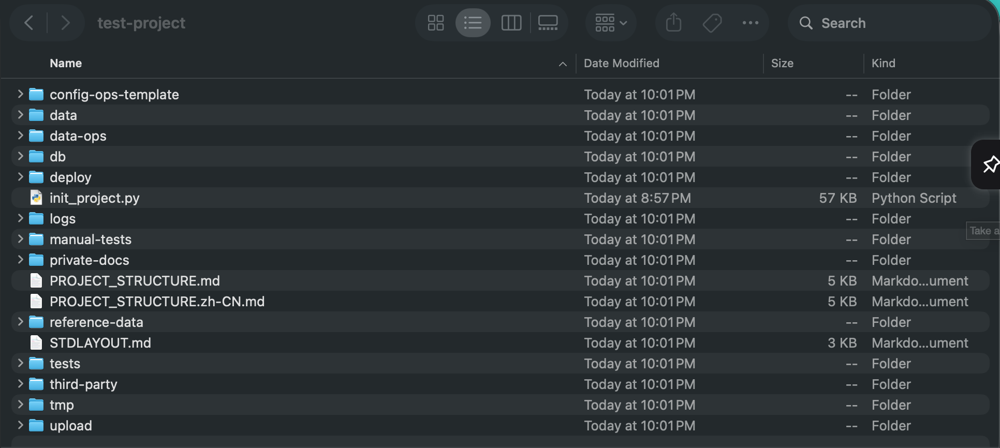

# PerformAI.org — Open-Source AI Lab

English · [中文](https://github.com/performai-org/.github/blob/main/profile/README.zh-CN.md)

**AI products, AI infrastructure and engineering tools, built to run at scale at the lowest possible cost.**

🌐 [www.performai.org](https://www.performai.org)

PerformAI.org builds AI products and the infrastructure behind them, from low-cost distributed inference to multi-modal speech and video pipelines. We hold every release to a high bar: a project is open-sourced only after its core development is complete and it has been thoroughly tested. Much of our work powers our own products and internal platforms, and what you see here is only the beginning. Follow us to be notified of new releases.

---

## AI products

| Product | What it does |
|---|---|
| **Background Removal** | Removes image backgrounds in one click, with transparent PNG output |
| **Text-to-Speech** | Natural speech in many languages and voice styles, including voice cloning that imitates a real person's voice |
| **Subtitle Generation** | Turns video or audio into subtitles in minutes |
| **Speech Translation** | Turns audio into translated subtitles |
| **Intelligent Assistant** | LLM-based conversational assistant, enhanced for each customer's scenario |

…and many more AI products. Try them at [www.performai.org](https://www.performai.org).

---

## Core technology

- **Low-cost distributed AI inference and LLM serving**
- **Multi-modal AI pipelines:** speech-to-text, text-to-speech, automatic subtitles and translation, intelligent video segmentation
- **E-book to static website:** turns e-books into searchable, SEO-friendly static websites with zero hosting cost, in production at [shenbi.org](https://shenbi.org)
- **Built-in Ops:** engineering infrastructure that lets a small team run a large number of projects

---

## Built-in Ops

AI-assisted coding makes development many times faster, and one person maintaining a hundred projects is becoming normal. Operations work grows with every project. Built-in Ops makes operations a property every project has from its first commit, with a target of **no more than 8 person-hours of manual operations per year, across all projects**.

| Function | Project | Status |
|---|---|---|
| Standard project layout and multi-language `.gitignore` | [stdlayout](https://github.com/performai-org/stdlayout) | ✅ Open source |

---

## Open-source projects

| Project | What it does |
|---|---|
| [stdlayout](https://github.com/performai-org/stdlayout) | One script that gives any project a standard directory layout and a complete `.gitignore` |
| [tech-books](https://github.com/performai-org/tech-books) | Technology books, free to read |
| [gitTools](https://github.com/performai-org/gitTools) | Utilities that simplify everyday git use |
| [element-plus-starter-ts](https://github.com/performai-org/element-plus-starter-ts) | Element Plus starter template with TypeScript enhancements |
| [quick-helper](https://github.com/performai-org/quick-helper) | npm module of useful JavaScript development functions, written in TypeScript |

[stdlayout](https://github.com/performai-org/stdlayout) can create a standard directory structure that facilitates operations and maintenance:

### Earlier open-source projects by our team members

| Project | What it does |
|---|---|
| [OXmlEd](https://sourceforge.net/projects/oxmled/) | Java library for converting between objects and XML |
| [Interface C++](https://sourceforge.net/projects/interfacecpp/) | Compact framework that brings interface-based, Java-style object-oriented design to C++ |

More on [SourceForge](https://sourceforge.net/u/shendl_s/profile/) and the [Google Code archive](https://code.google.com/archive/p/shendl/downloads).

---

## More projects

- [shenbi.org](https://shenbi.org) · [wiki](https://wiki.shenbi.org)

---

## Papers, articles and patents

### Papers by our team members
- *Beyond Patrol: A Hybrid Cloud-Edge Framework for Permanent Community Governance*. Zenodo, 2026. [DOI: 10.5281/zenodo.19703327](https://doi.org/10.5281/zenodo.19703327)

### Articles and columns by our team members
- *Calling Native Functions Easily with JNA*. Invited article, *Programmer* (《程序员》) magazine. [Read](https://blog.csdn.net/shendl/article/details/4362495)
- Column on CSDN. [Read](https://blog.csdn.net/shendl/)
- Column on InfoQ China. [Read](https://www.infoq.cn/u/shendl/publish)

### Patents by our team members
- CN105549905B: *一种多虚拟机访问分布式对象存储系统的方法* (A method for multiple virtual machines to access a distributed object storage system). [Google Patents](https://patents.google.com/patent/CN105549905A/zh)

### Community by our team members
- [Unix & Linux Stack Exchange](https://unix.stackexchange.com/users/edward-shen)

---

## Work with us

- **Partners and businesses:** for product integration, customization or cooperation, contact us through [www.performai.org](https://www.performai.org/introduction).
- **Developers:** found a bug or have a question? Open an issue in the project's repository. We are not accepting pull requests at the moment.
- **Stay updated:** follow this organization on GitHub.
